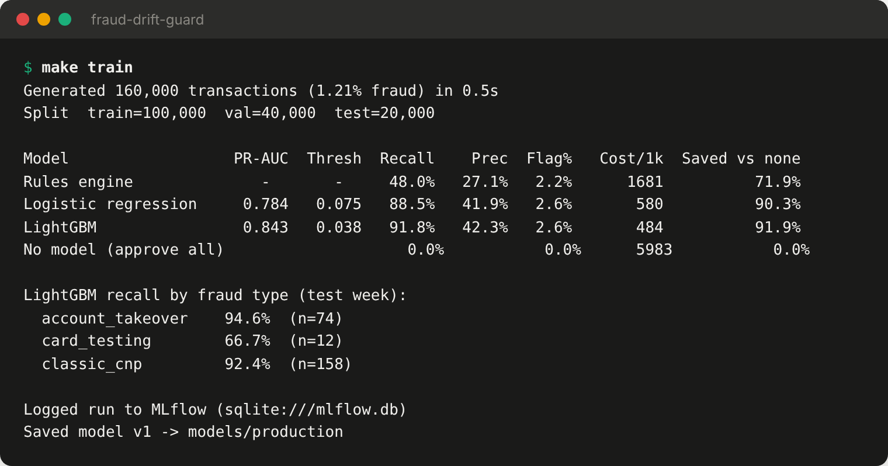
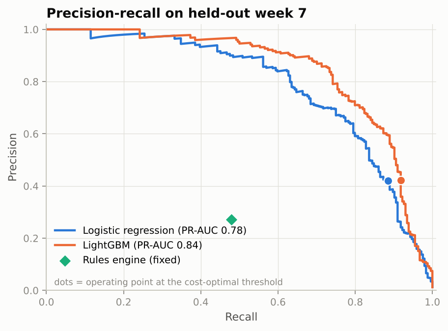
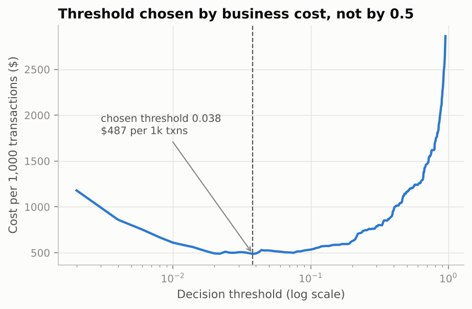
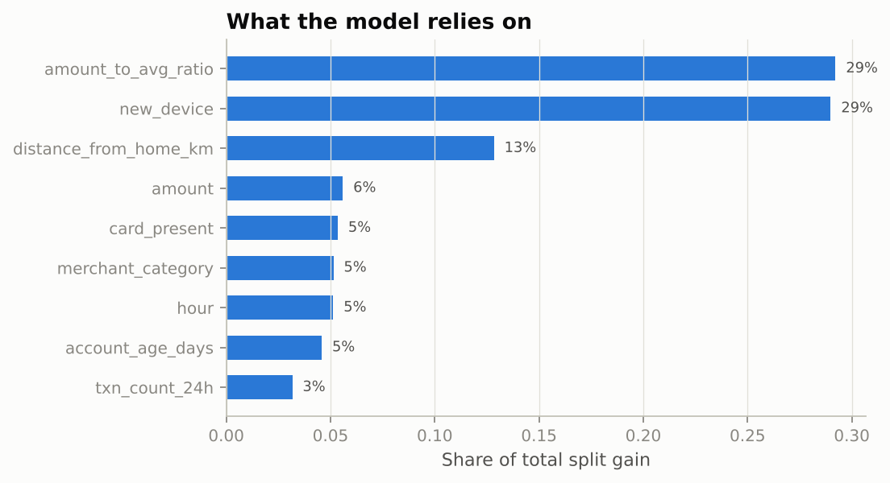
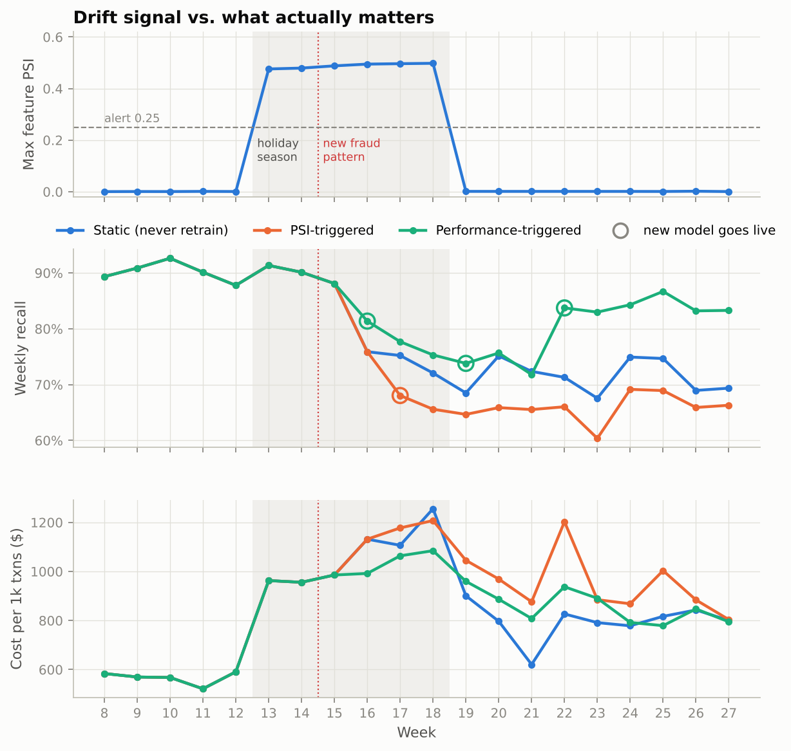
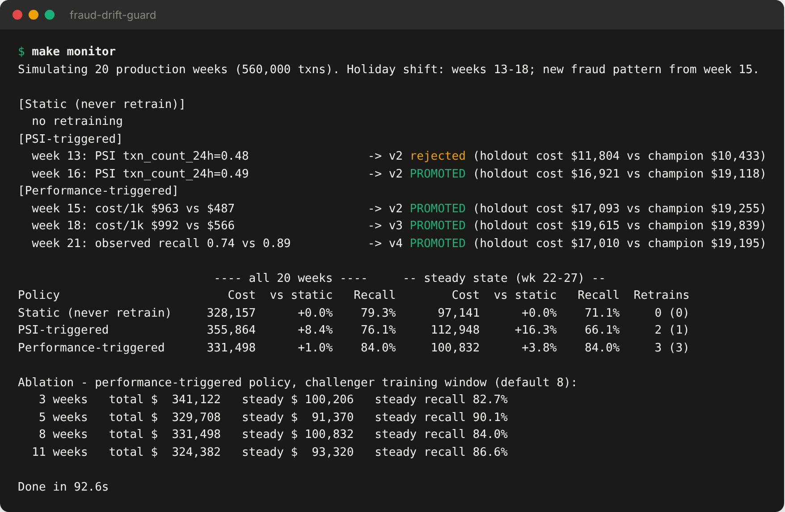
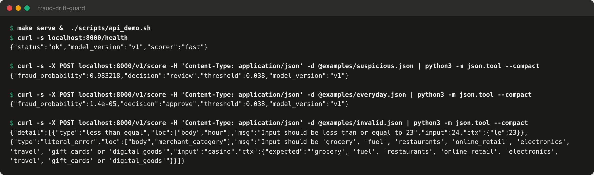
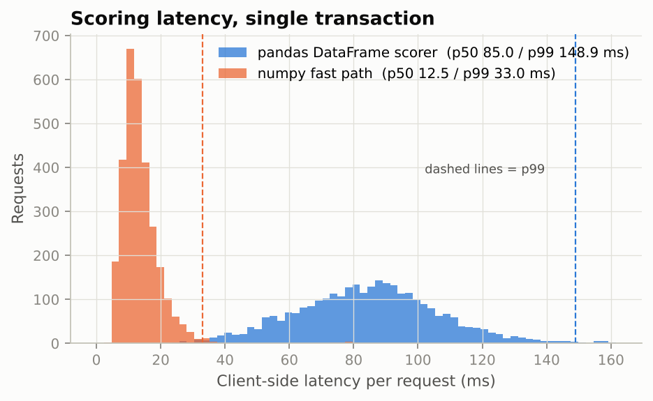
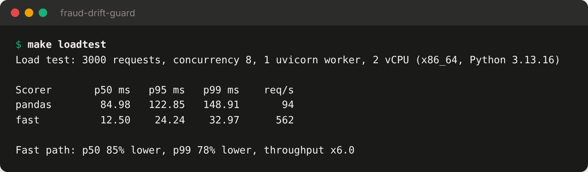
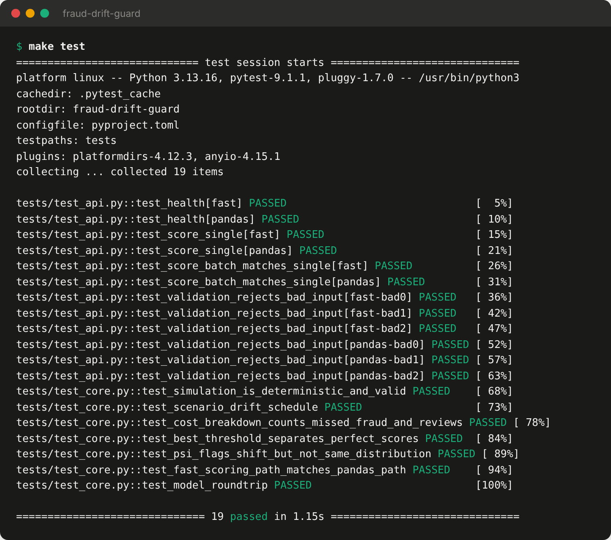

# fraud-drift-guard

**Real-time card-fraud scoring with a cost-optimised decision threshold, drift monitoring and gated retraining, tested against a simulated holiday season and a new fraud pattern.**

   [](https://github.com/Sree-Deekshitha/fraud-drift-guard/actions/workflows/ci.yml)

**[▶ Live demo](https://sree-deekshitha.github.io/fraud-drift-guard/)**: score transactions with the production model, which runs in your browser.

## The problem

A fraud model that looks great in a notebook usually degrades quietly once it's in production:

1. **The decision threshold is wrong.** A 0.5 cut-off ignores the fact that a missed $400 fraud costs far more than reviewing a legitimate purchase.
2. **Drift alarms fire for the wrong reasons.** Seasonal shopping changes trip distribution monitors (PSI) even when fraud hasn't changed, while a new fraud pattern can slip through without a feature-level alarm.
3. **Labels arrive late.** Chargebacks take about two weeks, so you can't measure live recall directly.

This project builds the full loop (train → choose threshold by cost → serve → monitor → retrain → gate → promote) and then stress-tests it on 20 simulated production weeks.

## Results at a glance

| | Result |
|---|---|
| Cost vs. existing rules engine | **$484 vs $1,681 per 1k transactions (−71%)** on the held-out week |
| Cost vs. approving everything | **−92%** |
| PR-AUC | **0.843** (LightGBM) vs 0.784 (logistic regression) |
| Serving latency | **p50 12.5 ms / p99 33 ms**, single request, 1 worker on 2 vCPU (pandas path: 85 / 149 ms) |
| Drift finding | Retraining when PSI fired **cost 8.4% more** than never retraining |
| Retraining finding | Performance-triggered retraining raised recall from **71% to 84%** but cost **3.8% more**. The root cause is analysed below. |

The data is simulated (see [Data](#data)), so these numbers show how the pipeline behaves under assumptions that are written down in the code. They are not benchmarks on real bank data.

---

## 1. Offline experiment: choosing the model and threshold by cost

Time-ordered split: train on weeks 0–4, validate on weeks 5–6, test on week 7. Thresholds are picked on validation to minimise

```
cost = Σ(missed fraud amount + $25 chargeback fee) + $12 × (flagged transactions)
```

and then frozen before touching the test week.



<p align="center">
  
  
</p>

- The cost-optimal threshold is **0.038**, nowhere near 0.5. Fraud is 1.2% of traffic and an average miss costs about 38× a review ($436 + $25 fee vs $12), so the curve is asymmetric.
- LightGBM beats logistic regression mainly through interactions (for example, a new device *and* a high amount relative to the customer's average). Logistic regression is still a respectable baseline at 0.78 PR-AUC.
- The rules engine has decent precision but **misses 52% of fraud**.



## 2. Production simulation: drift, delayed labels and three retraining policies

There are 20 production weeks (560k transactions). Weeks 13–18 are a **holiday season**, where legitimate customers buy more online, spend more and transact more often. From week 15 a **card-testing ring** ramps up: small test charges on digital goods and gift cards at high velocity, followed by cash-out purchases. It grows from 3% to 55% of fraud.

Each week the monitor computes PSI against the model's training profile. Labels arrive with a **2-week delay**. Any retrain produces a *challenger* that is promoted only if it beats the champion on the most recent labelled week.

| Policy | Retrains when |
|---|---|
| Static | never |
| PSI-triggered | any feature PSI > 0.25 |
| Performance-triggered | observed (label-delayed) recall falls > 8 pts below validation, or cost per 1k rises > 30% |





### What happened, and why

**PSI was a misleading signal.** It shot to 0.48 the moment the holiday started (`txn_count_24h`) and dropped back to zero afterwards. It never responded to the new fraud pattern, because card-testing is a small slice of traffic and barely moves the overall feature distributions. Retraining on the PSI alarm produced a model whose threshold was tuned on a holiday week. After the season ended it **missed more high-value fraud**: fraud losses over the 20 weeks were $212k vs $150k for the static model. It cost **+16% in steady state**.

**Performance-triggered retraining fixed the metric it was watching, but not the cost.** Recall in weeks 22–27 rose from 71% to 84%. Cost was still 3.8% higher than the static model. Breaking down the final model's errors in steady state:

| | Static v1 | Retrained v4 |
|---|---|---|
| Recall (count) | 71.1% | **84.0%** |
| Recall on card-testing | 55% | **82%** |
| Recall on classic CNP fraud | **91%** | 85% |
| **Recall weighted by $** | **93.5%** | 90.9% |

The retrained model's training window (weeks 10–17) was mostly holiday traffic, and its threshold was tuned on a holiday week. It learned to catch the many small card-testing charges and lost ground on the fewer, larger classic frauds. **Count-based recall rose while dollar-weighted recall fell.** That is why the policy is evaluated on cost, and why recall alone would have reported a success.

**Window ablation** (shown in the screenshot above): a 5-week window reached $91k / 90% recall in steady state, but I kept the 8-week default I had chosen beforehand. The ablation runs on the same simulated period, so choosing the "best" window from it would be selecting on the test set.

### What I'd do next
- Exclude or down-weight known seasonal weeks when training challengers, or validate the threshold on post-season data before promoting.
- Gate promotion on **$-weighted recall plus cost over 2+ labelled weeks** instead of one week of cost, which is noisy with only ~240–380 frauds per week.
- Add a dedicated velocity/BIN-level detector for card-testing, which is better caught as a *sequence* than per transaction.

## 3. Serving

FastAPI service with Pydantic validation, a fixed feature schema and a per-request timing header.



### Measured optimisation: dropping pandas from the hot path

Building a one-row DataFrame per request dominated latency. The fast path encodes the request straight into a NumPy row, using the same category codes as training; a test asserts identical predictions to 1e-9.

<p align="center"></p>



3,000 requests, concurrency 8, one uvicorn worker, 2 vCPU container. Latency is client-side and includes queueing.

## 4. Tests & CI



The tests cover deterministic simulation, cost accounting, threshold search, PSI sensitivity, model save/load round-trip, fast-path vs pandas parity, and API behaviour under both scorers (including 422s on invalid input). GitHub Actions runs them on every push.

---

## Data

The data is **simulated** in [`src/fraudguard/simulate.py`](src/fraudguard/simulate.py). Public fraud datasets either can't be redistributed or are anonymised into PCA components, and neither lets you *inject* a known drift and check whether monitoring catches it. The generator models three fraud types (classic card-not-present, account takeover, card-testing) plus legitimate behaviour: card-present vs online, travellers, power users, and new accounts. Every assumption is a named constant.

## Limitations

- Results depend on the simulated distributions and the cost constants (`$12` review, `$25` chargeback fee). Change them and the optimal threshold and policy ranking can change. That sensitivity is part of the point.
- Customer history features (`amount_to_avg_ratio`, `txn_count_24h`) are given as inputs. In production they would come from a feature store with point-in-time correctness.
- Each policy was run on one simulated timeline (one seed). Treat small differences (±2–3%) as noise.

## Run it

```bash
make setup      # pip install -r requirements-dev.txt && pip install -e .
make train      # experiment + model v1      (~10 s)
make monitor    # 20-week simulation         (~90 s on 2 vCPU)
make serve      # API on :8000, docs at /docs
make loadtest   # latency benchmark
make test
make docker     # containerised API
make web        # re-export the model for the browser demo (docs/)
```

Experiment runs are logged to MLflow (`mlflow ui --backend-store-uri sqlite:///mlflow.db`). All figures and screenshots in this README are generated by the scripts in `scripts/` from real runs. The screenshots come from `scripts/render_terminal.py`, which renders the captured logs in `reports/logs/` verbatim.

```
src/fraudguard/
  simulate.py   transaction stream + drift scenario
  costs.py      business cost model, threshold search
  model.py      LightGBM training, fast scoring path, save/load
  drift.py      PSI against a stored reference profile
  monitor.py    weekly loop, retraining policies, champion/challenger gate
  api.py        FastAPI service
scripts/        experiment, monitoring, load test, screenshot rendering, web export
docs/           live demo (GitHub Pages): index.html + scorer.js + model.json
reports/        JSON/CSV results + raw logs
```
